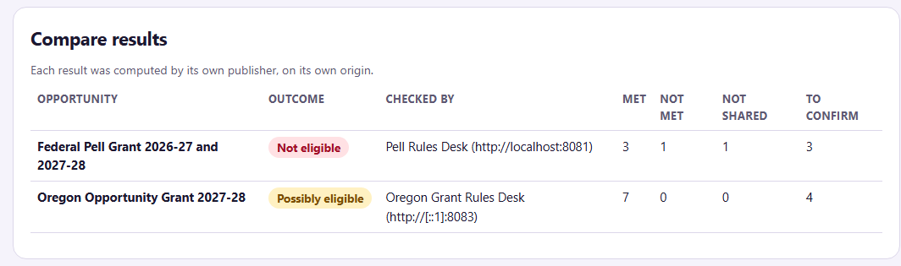
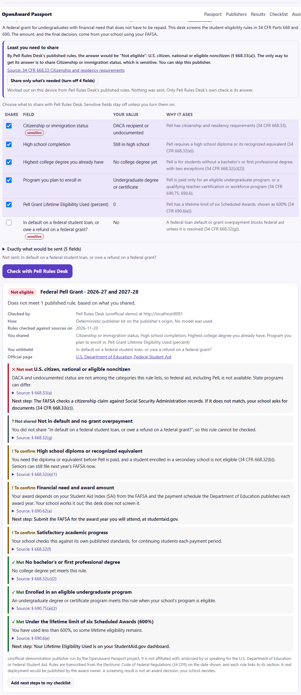

# Campus Sidequest

**Turn a gap between classes into a small campus adventure.**

Tell Sidequest what you feel like doing and how much time or money you have. With your
OK, it reads two independent student groups' public activity lists, each on the group's
own site, and builds up to three short plans in your browser. Nothing about you is sent
to the groups. Listings are demo examples, not scheduled events. There are no accounts,
bookings or payments.

There are two ways to ask, in one chat panel:

- **Quick chat (no key).** A small parser on the page that understands activities, mood,
  time and budget ("cards for 30 minutes, free"). An off-topic message gets a reply and
  contacts no one.
- **AI agent (your key).** The site's own agent network, `campus_sidequest`, runs in your
  browser on your AI provider key, through the agentic-web runtime. It sets the planner
  (`website_set_sidequest_choices`), builds the plan (`website_build_sidequest`, which asks
  you before any read) and can ask Makers Studio's or Campus Games' own agent what it
  offers: after the runtime's consent card, that group's network loads from the group's
  origin and runs here, on your key. Otari is the default router; OpenAI, OpenRouter,
  Google AI Studio, Groq, Anthropic and other OpenAI-compatible providers work too. The
  key is saved in your browser only. The runtime loads only when you switch to the agent.

## Run Sidequest locally

Requires Node.js 22 or newer. From this folder (`openaward/`):

```shell
node scripts/build.mjs
node scripts/serve-all.mjs
```

Open <http://127.0.0.1:8080/>. The activity sites run at `http://localhost:8081/` and
`http://[::1]:8083/`, each on a separate origin. All three are static sites. To host them,
use three HTTPS origins, run
`node scripts/retarget-sidequest.mjs --sidequest <hub> --maker <makers> --games <games>`, and
deploy `sidequest/`, `publishers/maker-studio/` and `publishers/campus-games/` to three
Netlify or Cloudflare Pages sites (the build writes each one's `_headers`). The original
scholarship demo is still available with `node scripts/serve-openaward-fallback.mjs` after
stopping the Sidequest servers.

### Sidequest checks

| Command | What it checks | Result |
| --- | --- | --- |
| `node --test tests/sidequest.test.mjs` | 14 tests: off-topic messages never start a plan, apostrophes, time and budget parsing, whole-word matching and ranking, every plan within time and budget for every setting, varied options, and the agent's actions, manifest and network staying in step | 14/14 |
| `node tests/e2e/run-sidequest-e2e.mjs` | 10 checks in headless Chrome with real servers on 3 origins and a scripted router with a fake key: no contact on load or for off-topic chat, consent and decline, GET-only reads with no key or cookie, "don't ask again in this tab", finishing a quest, the AI agent setting the planner and building after the page asks, Makers Studio's network loaded from its origin after the consent card, every model request on the visitor's router and key, no CSP violations | 10/10 |

The e2e checks start their own servers, so stop `serve-all.mjs` first.

Sidequest's limits: the AI path is tested with a scripted router, so how well a real model
follows the agent's instructions needs a live check with your own key. Quick chat knows the
listed activities' words (zines, badges, cards, puzzles, walks…), not arbitrary requests;
that is what the AI agent is for. Time and budget snap to the planner's options (30, 60 or
90 minutes; free, $5 or $10), rounding down so a plan never exceeds the visitor's limit.
The listings are fixed demo data, and the sites are not hosted yet.

See [`../docs/SIDEQUEST_PLAN.md`](../docs/SIDEQUEST_PLAN.md) for the product flow, network
design, privacy notes and remaining demo work.

---

## Archived product: OpenAward Passport

**Check grants without handing over your whole profile.**

OpenAward Passport is a set of three interlinked agentic websites built on the
[Worldwide Agentic Web MVP spec](../docs/worldwide_agentic_web_mvp_spec.md):

- **The passport** (the student's site). A student keeps an eligibility profile in their own
  browser and chooses, field by field and publisher by publisher, what to share.
- **Two independent award publishers** (peer sites on their own origins). Each one
  publishes its eligibility rules as data, with a verbatim quote and link to the official
  source for every rule. It screens only the fields a student sends, with its own code, on
  its own origin. Both are clearly labelled unofficial demos:
  - the **Pell Rules Desk** publishes the Federal Pell Grant's student-eligibility rules from
    34 CFR (eCFR, current to 2026-11-18);
  - the **Oregon Grant Rules Desk** publishes the Oregon Opportunity Grant's 2026-27 and
    2027-28 rules from OSAC's page (Last Updated October 2026).
- **The OpenAward publisher kit**. A small, reusable rules engine, a shared passport
  vocabulary and a result view, so any award owner can publish its rules the same way.

Before anything is sent, the passport works out, on the student's device and from each
publisher's published rules, **the least the student needs to share** for a definite answer.
Its assistant works for the student's privacy: it plans, can share less (never more), asks
publishers, and explains why their answers differ.

Every result says, rule by rule, **met**, **not met**, **not shared** or **to confirm**,
with its source, and the page shows exactly what left the browser and where it went.



## Why this is different

Scholarship matching already exists, and plenty of products send a full student profile to
one central service that returns a match score. OpenAward tests a different interaction
model, which the open agentic web makes possible:

| Usual matching site | OpenAward Passport |
| --- | --- |
| One service holds the whole profile | The profile stays in the student's browser |
| The service decides what fits | Each award's publisher evaluates its own published rules |
| Opaque score or "you match" | Rule-by-rule status with a verbatim source quote and link |
| Unknowns are hidden or guessed | A withheld field stays **not shared**; a rule only a school can settle stays **to confirm** |
| You fill in whatever the form asks | The passport plans the fewest fields that settle each answer, and says when a publisher is not worth telling something sensitive |
| An AI assistant that collects more about you | An assistant that can only share less: it turns sharing off, never on, and the page refuses any field you did not share |
| Integration per partner | Any publisher that speaks the passport vocabulary works, with no central registry |

The two demo publishers show why this matters. For the same sample student (Maya, an Oregon
high-school senior with DACA status), the Pell desk answers **not eligible**: 34 CFR 668.33
does not cover DACA. The Oregon desk answers **possibly eligible**: OSAC says DACA students
are eligible. Each publisher gives its own citation, and Maya decides what each one sees.
Before she shares anything, the passport tells her that by Pell's own published rule the
only way to get Pell's answer is to reveal her immigration status, for an expected "not
eligible". She can skip Pell.



We do not claim this is the first or only such system. See
[`../docs/PROJECT_PLAN.md`](../docs/PROJECT_PLAN.md) for the competitive scan and its limits.

## Try the archived OpenAward fallback (no key)

The original scholarship demo remains intact on disk. Stop the Sidequest servers first,
then run this from this folder (`openaward/`):

```shell
node scripts/build.mjs                  # builds both the fallback and Sidequest networks
node scripts/serve-openaward-fallback.mjs
```

Open <http://127.0.0.1:8080/> to load the fallback passport, then:

1. **Load sample · Maya**. The passport fills in. It is kept in this tab only.
2. **Read Pell Rules Desk's rules**. A dialog names `http://localhost:8081` and says nothing
   about you is sent. Nothing is contacted until you agree.
3. Read **Least you need to share**. Worked out on the page, with no contact, it says that
   by Pell's published rules the answer would be **Not eligible** (34 CFR 668.33(a)), and
   the only way to get it is to share citizenship, which is sensitive: you can skip Pell.
4. Look at **Choose what to share**. The sensitive fields, citizenship and loan default,
   are off. **Check with Pell Rules Desk**: the dialog lists the exact fields and values.
   The result says **Can't tell yet**, because you withheld citizenship.
5. Turn citizenship on and check again: **Not eligible**, as the plan said. Then **Share
   only what's needed** turns the other four fields off: one field is enough.
6. Read the Oregon desk's rules (`http://[::1]:8083`). The plan for **2027-28** says
   **Possibly eligible** and names the two fields to turn on yourself. Share citizenship and
   loan default, and check. The 2027-28 check does not even ask for your SAI, because OSAC
   has not published that year's limit.
7. Scroll to **Compare results** and **What left this page**.

The publishers' own pages, <http://localhost:8081/> and <http://[::1]:8083/>, show every
published rule with its source, so anyone can audit what a desk checks.

### With the assistant (your own key)

Each site embeds the reference browser runtime with Bring-Your-Own-Key. Open **AI model
settings** at the bottom of the passport and add a key. The default router is
[Mozilla's Otari](https://otari.ai/), and challenge registrants can claim free credits.
Then load Maya and ask:

1. *"Which publishers are worth asking, and what is the least I need to share with each?"*
   The page asks once, naming both publishers' origins, before the assistant reads their
   rules (nothing about you is sent). The assistant then explains each plan with its sources.
2. *"Follow the plan for the Federal Pell Grant."* The page shows what will change and asks
   first. The assistant can only turn sharing off.
3. *"Ask the Oregon Grant Rules Desk to check the 2027-28 grant with what I chose to share."*
   after turning on the fields its plan names. The runtime shows a consent card naming the
   publisher. This site adds the **full** request to the card, since the runtime itself
   shows only the first 140 characters. After you allow it, the publisher's network loads
   from its origin and runs in your browser on your key. Its answer appears on the page too.
4. *"Why do my Pell and Oregon results differ?"* and *"Add the next steps from my results to
   my checklist."*

On `localhost` the runtime keeps saved keys in a cookie for that host name, which is why the
three sites use three host names. Use a key with a low spending limit. Afterwards, delete the
saved setup under **Advanced settings** and close the tab.

## How it works

```text
 Student's browser
 ┌──────────────────────────────────────────────────────────────────────────────┐
 │ Passport page  http://127.0.0.1:8080                                         │
 │  passport (sessionStorage, or localStorage if chosen)   never sent by itself │
 │  privacy plan: kit/disclosure.js over published rules   no contact at all    │
 │  bridge guard: every message to a publisher checked against your choices     │
 │                                                                              │
 │  No-key path:  consent dialog ──► hidden sandboxed frame on publisher origin │
 │                                    runtime's ActionBridgeClient              │
 │                                    get_published_rules / check_eligibility   │
 │                                                                              │
 │  Assistant:    passport_assistant ──(consent card)──► publisher network URL   │
 │                (visitor's router + key)               loaded from its origin  │
 │                                                       and run HERE, on the    │
 │                                                       visitor's model         │
 └──────────────┬───────────────────────────────────────────────┬───────────────┘
                │ only the fields the student turned on         │
   ┌────────────▼─────────────────────┐          ┌──────────────▼────────────────────┐
   │ Pell Rules Desk  localhost:8081  │          │ Oregon Grant Rules Desk  [::1]:8083│
   │ rules.json  (openaward-rules/v1) │          │ rules.json                         │
   │ bridge/bridge-actions.js         │          │ bridge/bridge-actions.js           │
   │   └ kit/eligibility.js (no model)│          │   └ kit/eligibility.js (no model)  │
   │ pell_rules_desk.network.json     │          │ oregon_grant_desk.network.json     │
   │   front agent + checker agent    │          │   front agent + checker agent      │
   └──────────────────────────────────┘          └────────────────────────────────────┘
```

- **Portable networks (Tenet 1).** Each site has a Neuro SAN HOCON network, resolved to
  `<network>.network.json` by the skill's `build_network.mjs`, which validates it with the
  runtime's own parser. Each publisher's network has two agents: a front agent and a checker
  specialist.
- **Browser execution and site composition (Tenet 2).** The passport's agent lists each
  publisher's network URL as a tool. After consent, the runtime resolves the publisher's
  `agent-manifest.json`, requires an exact network-name match, loads the network and runs it
  in the student's browser. The publisher's `check_eligibility` read runs in a frame on the
  publisher's own origin, through its action bridge. The no-key page flow uses the same
  bridge protocol, through the runtime's `ActionBridgeClient`.
- **Pluggable inference (Tenet 3).** The default router is Otari; any OpenAI-compatible
  router works through BYOK. Publishers run on the caller's router and model and never see
  the key. The eligibility decision itself uses no model: it is deterministic publisher code.

### What the agents do

The passport's agent is the student's privacy advocate. The model does the conversation:
deciding what to ask whom, explaining plans and results, and acting with the student's OK.
Code does the parts that must be exact:

| Step | Agent | Grounded in |
| --- | --- | --- |
| Read every publisher's rules | `passport_assistant` | `website_read_publisher_rules`: one page dialog naming each origin; nothing personal sent |
| Plan the least to share, and say when to skip a publisher | `passport_assistant` | `website_plan_disclosure`: the kit's planner over the published decision tables, on the device |
| Share less | `passport_assistant` | `website_apply_disclosure_plan`: turns sharing off only, after a page dialog showing the change |
| Ask a publisher | `passport_assistant` → publisher's front agent → its checker | `website_prepare_publisher_request`, then the publisher's network, loaded from its origin after the consent card; its `check_eligibility` runs on its origin |
| Explain differences, build the checklist | `passport_assistant` | each result's rules and sources; `website_add_checklist_item` after a page dialog |

Each answer the assistant gets from a publisher is also recorded on the page, from the
bridge request itself, in **Compare results** and **What left this page**.

### Privacy by construction

- The passport is never sent anywhere by itself. A publisher receives only the fields the
  student turns on for that opportunity. Sensitive fields (citizenship, SAI, loan default)
  start off.
- The publisher's check refuses unknown keys (JSON Schema `additionalProperties: false`)
  and drops fields its opportunity did not request before any rule runs.
- The privacy plan is worked out on the device from published rules. Planning contacts no
  one.
- The assistant's status and plan tools name fields, **not their values**. A plan does say
  what a rule would decide, so its reason can tell the visitor's own model what a value
  means (for example, that a citizenship status does not qualify for Pell). Values reach
  the model only in one prepared request, built by the page from what the student turned on.
- The assistant can share less, never more. Turning a field on is always the student's click.
- **Bridge guard.** Every message this page sends to a publisher's action bridge, from the
  page or from a publisher network the assistant runs here, is checked first
  (`passport/js/bridge-guard.js`). A field the student did not share for that opportunity,
  or a value that differs from the passport, is refused before it is posted, and logged.
  Whatever a model writes, it cannot get an unshared field to a publisher.
- Each page sends a Content-Security-Policy with `script-src 'self'`, so no third-party
  script runs next to a key.
- **What left this page** logs every contact: origin, purpose, decision, and the fields sent.

## Publish your own award (the kit)

An award owner needs three things: a `rules.json` in the `openaward-rules/v1` format, a
page, and the kit. See [`kit/README.md`](kit/README.md). The validator fails closed: a rule
with no verbatim source quote, a requested field no rule uses, or an enum value without an
explicit answer all stop the build. The kit also has the disclosure planner a passport uses
to plan the least to share with your desk, from your published rules.

## Tests and evidence

| Command | What it checks | Result |
| --- | --- | --- |
| `node scripts/build.mjs --check` | Runtime and kit copies are byte-identical; all 3 networks pass the skill's build checks | pass (one CRLF-only warning on Windows checkouts, explained in the output) |
| `node --test "tests/*.test.mjs"` | 50 unit tests. OpenAward's 36: engine semantics, every boundary of both rule sets against their sources, validator, the disclosure planner (minimal, and confirmed by the publisher's own check), the bridge guard, safe rendering, data minimization. Sidequest's 14 are listed above | 50/50 |
| `node tests/e2e/run-e2e.mjs` | 10 checks in headless Chrome with real servers on 3 origins, from the publishers' own request logs, including the privacy plan with no contact | 10/10 |
| `node tests/e2e/run-assistant-e2e.mjs` | 10 checks of the full agent path with a scripted router and fake key: plan, share less, check, the page's record, the guard | 10/10 |
| `node ../skills/agentify-website/scripts/check_partner.mjs http://localhost:8081/pell_rules_desk --origin http://127.0.0.1:8080` | The skill's own partner check, for each publisher | OK |

[`docs/CONFORMANCE.md`](docs/CONFORMANCE.md) maps each applicable MUST in the spec to code
and to the test that shows it. [`docs/SOURCES.md`](docs/SOURCES.md) records where each rule
came from and how it was retrieved.

## Deploying

The three folders `passport/`, `publishers/pell-desk/` and `publishers/oregon-desk/` are
static bundles. **They must be on three different origins**, which is what makes the
publishers independent peers. GitHub Pages project sites share one origin, so use three
Netlify or Cloudflare Pages sites. The build writes each site's `_headers`: CORS on the
public agent files only, and the sandbox worker's CSP.

```shell
node scripts/retarget.mjs --passport https://<passport host> --pell https://<pell host> --oregon https://<oregon host>
```

This rewrites the publisher URLs, the passport's `allowed_peers` and consent-card labels,
and the CSP, then rebuilds. `node scripts/retarget.mjs --local` switches back.

## Limits (honest list)

- The assistant path is tested end to end with a **scripted** router: consent, cross-origin
  loading, the key and model rules, and the publisher's own check. How well a given real
  model follows the agents' instructions needs a live check with your own key.
- The publishers are **unofficial demos** run by this project, transcribing official rules on
  the dates shown. A real deployment would be published by the award owner.
- A screening result is **not an award decision**. Financial need, award amounts, academic
  progress and a school's participation are always **to confirm**.
- Each rule set covers what can be screened from a profile, not every condition in the law.
- On the Oregon residency rule, out-of-state members of tribes with traditional ties to
  Oregon "may be considered Oregon residents". The desk explains this exception but does not
  screen it.
- The request text the assistant passes to a publisher's network goes to that network's
  agents, which run in this page on the visitor's own model. A model could add words to it.
  What reaches the publisher's origin is the check's structured fields, and the bridge guard
  refuses any field the student did not share. The guard wraps the runtime's
  `ActionBridgeClient.prototype.request`, so a runtime upgrade must keep that method.
- A plan is a preview from published rules. It matches the publisher's check only while
  the published rules are the ones the publisher runs: here both come from the same
  `rules.json`.
- The runtime is the agentify-website skill's patched copy of nsdeploy (see
  `../skills/agentify-website/runtime/README.md`). It shows its own dialog only for
  `irreversible` actions, so the passport's two writes (following a plan, adding a
  checklist item) show the page's own dialog with the destination and arguments.
- Published network files, including instructions, are public by design (spec section 1.1).

## Files

```text
openaward/
  kit/                        the reusable kit: rules engine, disclosure planner, result view (copied into each site by the build)
  passport/                   the student's site: page, network, manifest, site actions, bridge guard
  publishers/pell-desk/       Pell Rules Desk: rules.json, page, network, manifest
  publishers/oregon-desk/     Oregon Grant Rules Desk: rules.json, page, network, manifest
  scripts/                    build.mjs, serve-all.mjs, retarget.mjs, retarget-sidequest.mjs, serve-openaward-fallback.mjs
  tests/                      unit tests, and e2e/ for the two headless-Chrome checks
  docs/                       CONFORMANCE.md, SOURCES.md, SUBMISSION.md, screenshots/
```

Each site's `runtime/`, `kit/`, `bridge/`, `.well-known/`, `agent-mcp.json`, `_headers` and
`*.network.json` are written by the build. Edit the sources, not those.

## License

Apache License 2.0, as the agentic-web repository. The runtime in each site is nsdeploy's
(Apache 2.0); see its `LICENSE.txt`. Rule quotes come from the eCFR (U.S. government work)
and from OSAC's public page, with links.
